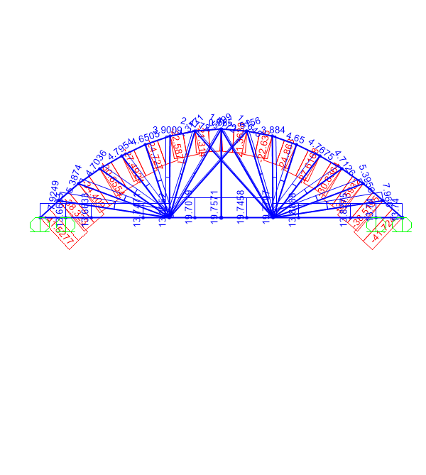

# Spaghetti Bridge: Truss and Arch Concept Models (SAP2000)

Concept models for a spaghetti model-bridge design, built in **SAP2000 26.3** to compare a flat truss with an arch truss before building.

**Status:** 🚧 Concept stage. Models analysed; member checks against spaghetti strength not done yet.

## Models

| Model | Geometry | Members and material | Loading |
|---|---|---|---|
| `basic` (flat truss) | 0.8 m span, 0.2 m deep, 0.1 m wide | 75 members, Ø5.5 mm spaghetti rods (custom material: E = 5 GPa, γ = 12.75 kN/m³) | Single point load (500 force units) |
| `arch` (arch truss) | 0.7 m span, rise ≈ 0.17 m, 0.125 m wide | 89 members; still using a placeholder steel section | Distributed load on the deck members |
| `arch 2` | The arch geometry scaled to a 70 m span | 87 members, placeholder steel section | Two point loads |

Supports: `basic` is pinned at four bearing joints; the arch models use vertical (roller) supports at eight joints.

## Next steps

- Assign the spaghetti section to the arch models
- Check member axial forces against the tensile strength and buckling capacity of spaghetti
- Compare the concepts by predicted failure load per unit self-weight

## Files

| File | Description |
|---|---|
| `basic.sdb`, `arch.sdb`, `arch 2.sdb` | SAP2000 models |
| `basic.$2k`, `arch.$2k`, `arch 2.$2k` | Plain-text exports of the models |
| `arch.BMP` | Axial force screenshot of the arch model |
| `images/arch-truss-axial.png` | PNG copy of the screenshot |

Open the `.sdb` files in SAP2000 24 or later and run the analysis.
